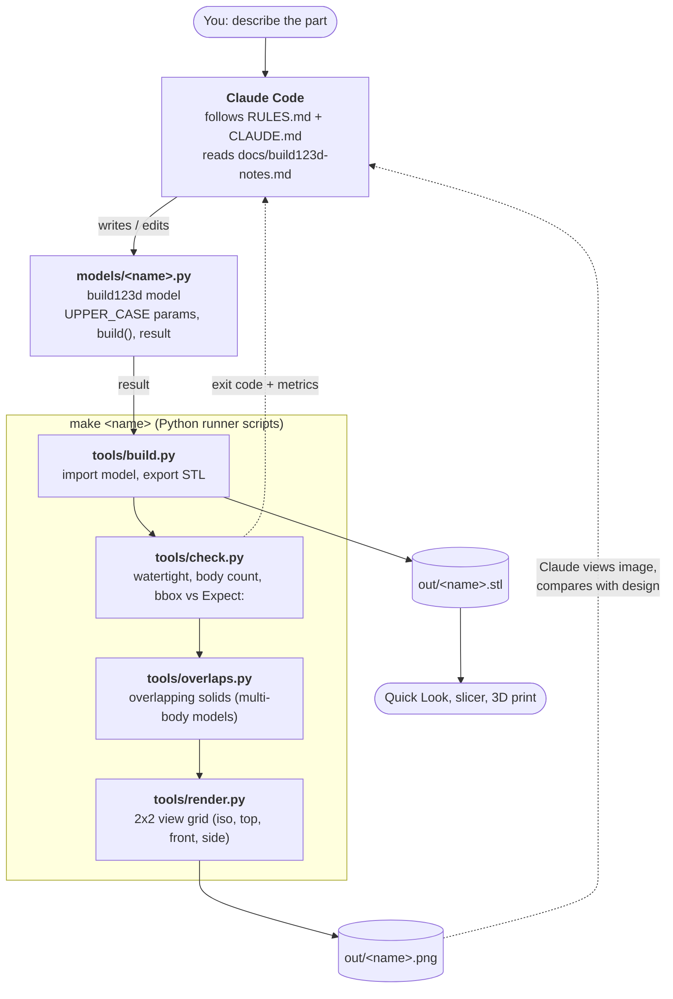
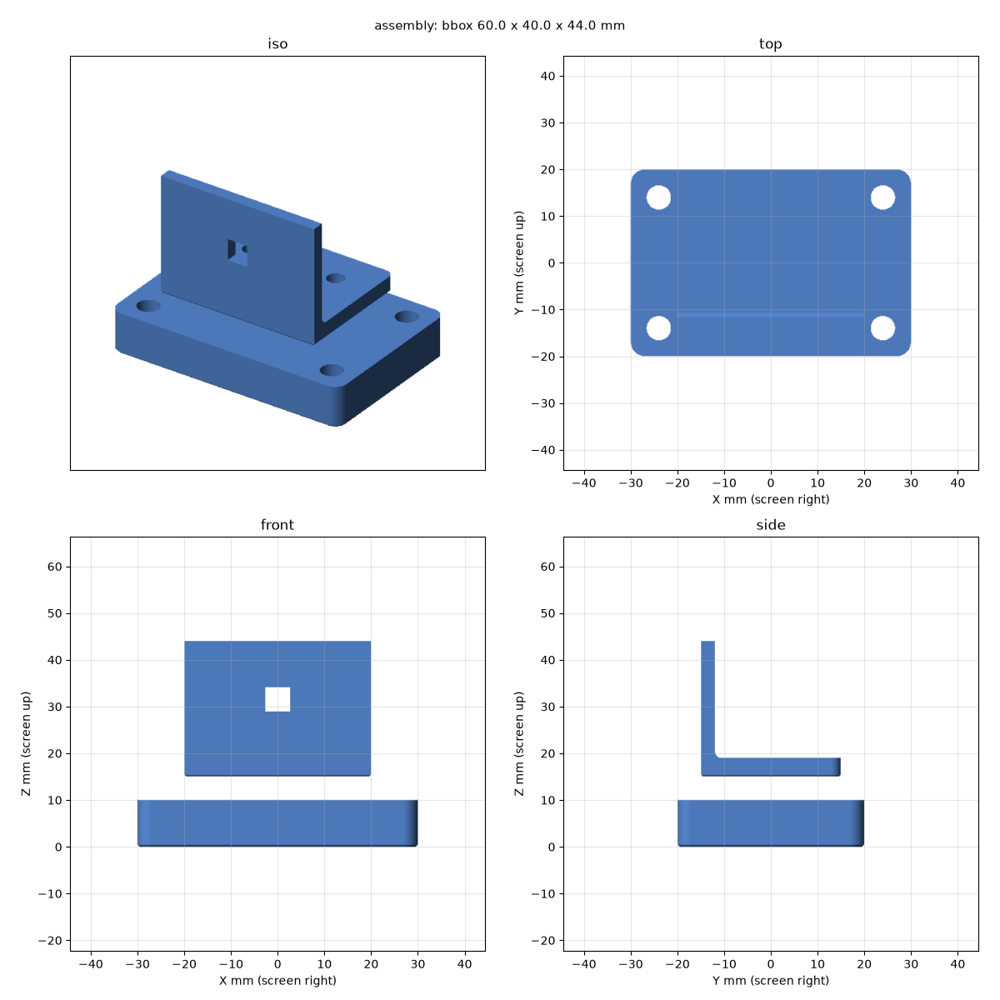

# example-base

Template repository for agentic parametric CAD: an AI coding agent (Claude Code) plans and writes [build123d](https://build123d.readthedocs.io/) models (Python, OpenCascade), then verifies them with a build, check and render loop. Parts are mm-precise and exported as STL for FDM 3D printing (0.4 mm nozzle, PLA/PETG).

The template is deliberately minimal. It carries the rules, the tooling and three small example models. A real project is created from it and replaces the examples.

Derived example: [example-stool](https://github.com/agentic-3d/example-stool), a scale-model stool split into glued printed parts.

## How it works

Claude Code writes and edits the model script. The `make` loop (Python runner scripts) builds, checks and renders it, and Claude reads the results and iterates until the part matches the design.



Solid arrows are data flow, dashed arrows are feedback to Claude. `models/*` is the only thing Claude edits; `tools/` and `make` are fixed runners.

## What you get

| File | Purpose |
|---|---|
| `RULES.md` | Design planning rules for the agent: requirements, orientation, splitting and joints, feature order, FDM rules, plan block, verification |
| `CLAUDE.md` | Guidance for Claude Code: commands, architecture, gotchas, how the template inheritance works |
| `Makefile` | Builds, checks and renders every model, and syncs the two files above and `tools/` from this repo |
| `tools/` | The `make` loop: `build.py` (STL export), `check.py` (watertight, body count, bbox against the `Expect:` line), `overlaps.py` (overlapping solids), `render.py` (2x2 view grid as PNG). On demand: `sections.py`, `printcheck.py`, `diff.py`, `overlay.py` (see Optional checks) |
| `docs/build123d-notes.md` | Verified build123d API notes and print recipes |
| `models/` | `common.py` (shared print constants) and the example models |

## Start a project from this template

1. Create the repository: "Use this template" on GitHub, or

   ```bash
   gh repo create my-part --template agentic-3d/example-base --clone
   ```

2. Install the dependencies (Python >= 3.12 and [uv](https://docs.astral.sh/uv/)) and build the examples once:

   ```bash
   uv sync
   ```

   ```bash
   make
   ```

3. Delete the example models (`models/plate.py`, `models/bracket.py`, `models/assembly.py`) and their files in `out/`, add your own and list them in `MODELS` in the `Makefile`.
4. Rewrite `README.md` for your project. Leave `CLAUDE.md` and `RULES.md` untouched.

## Who owns which file

| Files | Owner | In a derived project |
|---|---|---|
| `CLAUDE.md`, `RULES.md`, `tools/*.py` | base | overwritten by `make sync-base`, never edited locally |
| `README.md`, `Makefile`, `models/*` | project | all project-specific facts live here |
| `docs/`, `models/common.py`, `pyproject.toml` | project | start as copies of base, may diverge, not synced |

To pull the current rules into a derived project:

```bash
make sync-base
```

It downloads these files from the `main` branch of this repository with `curl` (`BASE_TOOLS` in the `Makefile` lists the scripts). A project made before the tools were base-owned copies the `BASE_TOOLS` / `BASE_FILES` lines and the `overlaps.py` recipe line from this `Makefile` once. Review `git diff` before committing. A rule that should change is changed here first, then synced.

## Example models

| Model | Description | Expected bbox (mm) |
|---|---|---|
| `plate` | Mounting plate with four corner holes | 60 x 40 x 10 |
| `bracket` | L-bracket with filleted joint and rectangular wall hole; reuses `plate` for its base | 40 x 30 x 29 |
| `assembly` | Exploded view of `plate` and `bracket` (2 bodies, gap between them) | 60 x 40 x 44 |

They show the three patterns a project needs: a parametric part with `build(...)`, a part that reuses another one, and a multi-body compound.



## Usage

Run everything from the project root.

```bash
make                # build, check and render every model
make plate          # one model
make clean          # remove out/ (rebuild with make before committing)
open out/plate.stl  # preview with macOS Quick Look
```

`make <name>` runs the loop for one model:

- `tools/build.py <name>` writes `out/<name>.stl`.
- `tools/check.py <name> [--bodies N]` verifies the mesh is watertight, has the expected body count (default 1) and prints the bbox. It also compares the bbox with the `Expect:` line of the model header (0.1 mm) and the extents with `BED_MAX` when that line names it. It exits non-zero on failure.
- `tools/overlaps.py <name>` runs only for models with a `BODIES_` line. It fails when two solids of the result overlap, which `check.py` cannot see.
- `tools/render.py <name>` writes `out/<name>.png`, a 2x2 view grid (iso, top, front, side) with true-mm axes.

After changing a model, run `make`, so every model that imports it is rebuilt too (`plate` -> `bracket` -> `assembly`). `out/` is committed: commit the regenerated STL and PNG files together with the model.

## Layout

```
models/
  common.py     shared print constants (CLEARANCE, MIN_WALL, HOLE_COMP, BED_CHAMFER, BED_MAX, ...)
  plate.py      one model per file; UPPER_CASE parameters at the top, exposes `result` and `build(...)`
  bracket.py
  assembly.py
tools/          build, check, overlaps, render and the on-demand analysis scripts (base-owned)
docs/           build123d API notes and print recipes
out/            generated STL/PNG output (committed, so GitHub shows the results)
Makefile        model list and targets
RULES.md        design planning rules (base-owned)
CLAUDE.md       guidance for Claude Code (base-owned)
```

## Optional checks

Run from the project root when the loop is green and the question fits. They are base-owned like the rest of `tools/`, so every derived project has them after `make sync-base`.

| Command | What it answers |
|---|---|
| `uv run python tools/overlaps.py <name> --near 1` | Which solid pairs are closer than 1 mm, and is any gap below `CLEARANCE` (`tight`)? |
| `uv run python tools/sections.py <name> --z 3` | What does the part look like inside at X, Y or Z = value (sockets, pockets, wall thickness)? Writes `out/<name>.<axis><value>.png`, a throwaway file |
| `uv run python tools/printcheck.py <name>` | How much surface is an overhang above 45 degrees, where is it, how big is the bed contact, does it fit `BED_MAX`? Report only; `--fail-over PCT` turns it into a gate |
| `uv run python tools/diff.py <name> [--ref REV]` | How did the rebuilt STL change against the committed one (bbox, volume, area, bodies, centroid)? |
| `uv run python tools/overlay.py <name> <drawing.png> <view> <px/mm x> <px/mm y> <origin x> <origin y> <out.png>` | Does the model match a drawing, scan or photo? Red = silhouette, `--edges MM` adds depth steps in blue |

`overlay.py` takes the drawing scale per axis (drawing pixels per model mm), because scans are often stretched: measure two known dimensions on each axis. `--rotate` deskews, `--crop` and `--zoom` pick the detail, `--shift` moves a part that is modelled in print orientation. The script header lists everything.

## Adding a model

1. Follow [RULES.md](RULES.md) and read [docs/build123d-notes.md](docs/build123d-notes.md) first.
2. Create `models/<name>.py` with named parameters (mm, Z up, origin at bottom center), a `build(...)` function and a `result`.
3. Add `<name>` to `MODELS` in the `Makefile`, after the models it imports. Set `BODIES_<name>` if it is a compound of several parts.
4. Run `make <name>` and compare `out/<name>.png` with the intended design.

## Print rules

Minimum wall 1.2 mm, fit clearance 0.2 mm per side, overhangs at most 45 degrees from vertical. Constants live in `models/common.py`, so import them rather than redefining them.
